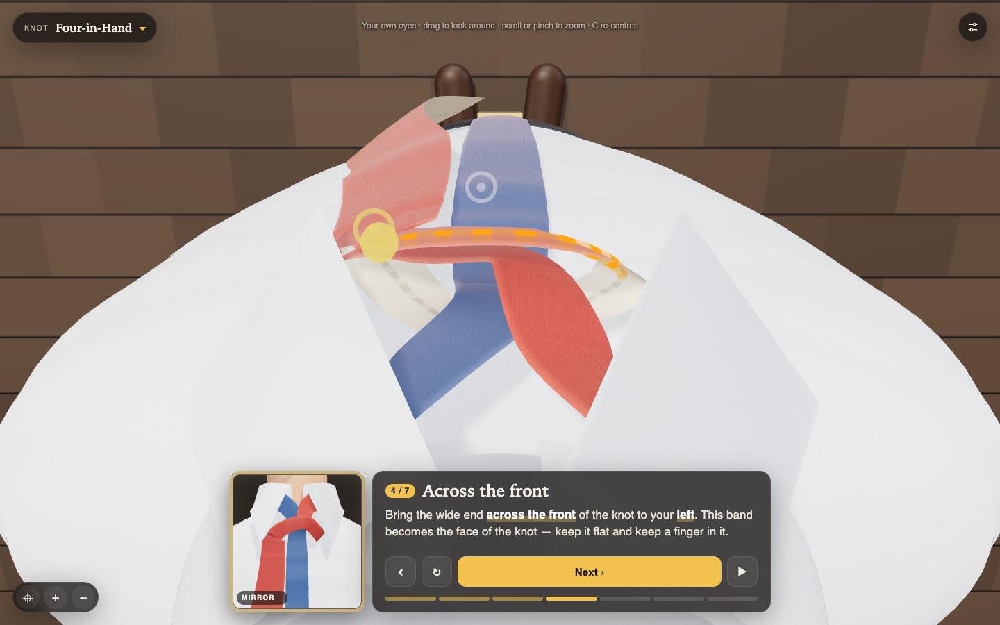

# Tie POV

Learn to tie a tie from your own point of view. Nine necktie knots and a bow tie, shown in 3D through your own eyes, with a mirror beside the instructions.

**Live:** https://necktie.fit



## Run

```sh
npm install
npm run dev      # local dev server
npm run build    # typecheck + static build into dist/
```

Pushing to `main` builds and publishes to GitHub Pages (`.github/workflows/pages.yml`).

## Keys

| Key | Does |
| --- | --- |
| `←` `→` | back / next move |
| `A` | show the move again |
| `Space` | play all / pause |
| `R` | start over |
| `1` `2` `3` | POV / mirror / orbit |
| `C` `+` `−` | re-centre, zoom |
| `K` | choose a knot |

## Links

Deep links use the URL hash, e.g. `#knot=windsor&step=3&view=mirror`.
Experimental looks: `#look=atelier`, `woodblock`, `blueprint`, `riso`, `noir`.

## Code

- `src/knots/` knot definitions (Fink–Mao sequences, bow tie)
- `src/tie/` the tie itself: choreography, rope sim, ribbon mesh, fabric
- `src/scene/` body and head
- `src/looks.ts` alternate art directions
- `scripts/` Playwright screenshot and behaviour checks (`node scripts/check.mjs` against a dev server on port 5199)
